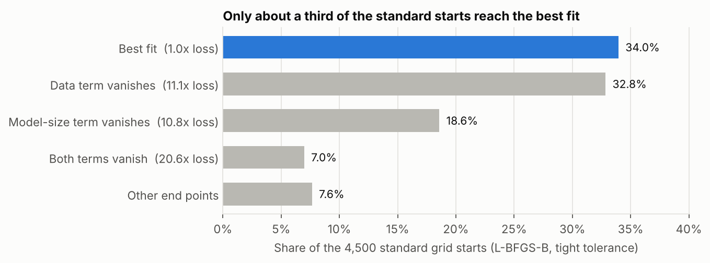
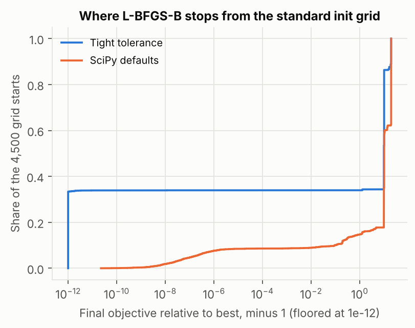
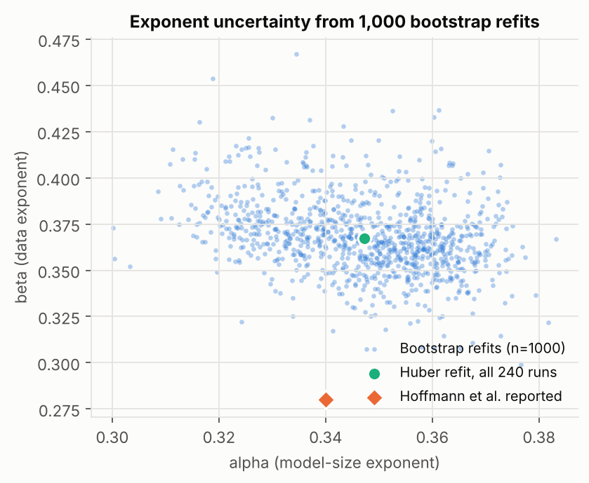
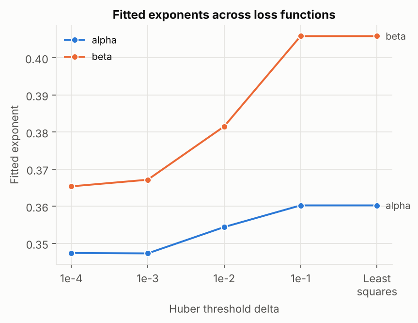
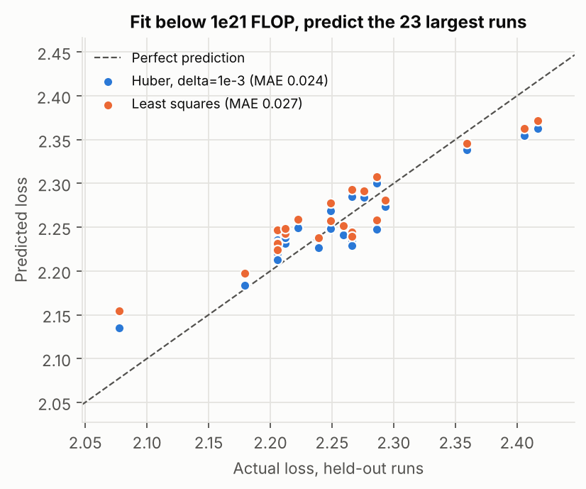

<div align="center">

# chinchilla-refit

**How much does a fitted scaling law depend on the procedure that fits it?**

A reproducible refit of the Chinchilla parametric loss on the published training runs,<br>
covering the parts of estimation that usually go unreported.

[](https://github.com/ysham123/chinchilla-refit/actions/workflows/tests.yml)

[](LICENSE)
[](https://arxiv.org/abs/2203.15556)
[](https://arxiv.org/abs/2404.10102)

[Findings](#findings) · [Method](#method) · [Results](#results) · [Reproduce](#reproduce) · [Limits](#limits)

</div>

---

<p align="center">
  
</p>

## Findings

| | Finding | Evidence |
| :---: | --- | --- |
| **1** | **The refit reproduces Epoch AI's published result.** | E = 1.817, alpha = 0.3473, beta = 0.3672 on the same 240 runs. The objective agrees to within 2e-11. |
| **2** | **Most starting points end in degenerate fits.** | Only **34.0%** of the standard 4,500 L-BFGS-B starts reach the best optimum, and **7.6%** at SciPy default tolerances. Most of the rest stop where one or both power-law terms vanish, at 11x to 21x the loss. |
| **3** | **The published values sit outside the bootstrap intervals.** | 1,000 bootstrap refits give 95% intervals that exclude the published E, B, beta, and compute-optimal exponent. The published values have 4x the fitted objective on these runs. |
| **4** | **The loss function moves the exponents.** | Switching from Huber (delta = 1e-3) to least squares raises beta from 0.367 to 0.406, about half the width of its bootstrap interval. |
| **5** | **Extrapolation favors Huber only slightly.** | Fit below 1e21 FLOP, the 23 largest runs are predicted with mean absolute error 0.024 (Huber) vs. 0.027 (least squares). With 23 runs I would not call that a meaningful difference. |

## Method

### The model

```math
L(N, D) = E + \frac{A}{N^{\alpha}} + \frac{B}{D^{\beta}}
```

Following Hoffmann et al., parameters are fit in log-sum-exp form, with $A = e^{a}$, $B = e^{b}$, $E = e^{e}$:

```math
\log \hat{L} = \operatorname{LSE}\left(a - \alpha \log N,\; b - \beta \log D,\; e\right)
```

The objective is a Huber loss (delta = 1e-3) on log-loss residuals, minimized with L-BFGS-B from every point of the standard grid:

| Parameter | Grid |
| --- | --- |
| alpha, beta | 0, 0.5, ..., 2 |
| e | -1, -0.5, ..., 1 |
| a, b | 0, 5, ..., 25 |

That makes 4,500 starts, and the best end point is kept. Gradients are analytic and checked against finite differences in the tests. "Tight tolerance" means `ftol=1e-15, gtol=1e-12`.

The compute-optimal allocation uses Hoffmann et al.'s closed form, $N_{opt} \propto C^{a}$ and $D_{opt} \propto C^{b}$, with $a = \beta / (\alpha + \beta)$ and $b = \alpha / (\alpha + \beta)$.

### The data

Epoch AI extracted 245 (model size, training FLOP, loss) points from the SVG of Hoffmann et al.'s Figure 4 ([Besiroglu et al., 2024](https://arxiv.org/abs/2404.10102); [data repo](https://github.com/epoch-research/analyzing-chinchilla)). Their repo has no license, so this one **downloads the CSV on first run** instead of redistributing it. Tokens come from $C = 6ND$. Following Epoch's analysis, the 5 highest-loss runs are excluded, which leaves **240 runs from 1.4e18 to 1.3e22 FLOP**.

## Results

### 1. Validation against Epoch AI

| | E | A | B | alpha | beta | Objective |
| --- | ---: | ---: | ---: | ---: | ---: | ---: |
| **This repo** | 1.8172 | 477.83 | 2143.4 | 0.34731 | 0.36717 | 1.01827402e-3 |
| Epoch AI grid fit | 1.8172 | 477.84 | 2143.9 | 0.34731 | 0.36718 | 1.01827403e-3 |
| Hoffmann et al., published (rounded) | 1.69 | 406.4 | 410.7 | 0.34 | 0.28 | 4.12e-3 |

### 2. Where the optimizer stops

<table>
<tr>
<td width="50%"></td>
<td width="50%">

| Share of starts | Loss vs. best | alpha | beta | End point |
| ---: | ---: | ---: | ---: | --- |
| 34.0% | 1.0x | 0.347 | 0.367 | Best fit |
| 32.8% | 11.1x | 0.263 | 1.89 | Data term vanishes |
| 18.6% | 10.8x | 1.68 | 0.179 | Model-size term vanishes |
| 7.0% | 20.6x | 10.8 | 10.7 | Both vanish, constant loss |

</td>
</tr>
</table>

With SciPy's default L-BFGS-B tolerances, only **7.6%** of starts land within 1e-6 of the best objective, though the best start still finds the same optimum. The grid is what makes the published procedure work. A fit from one start, or from a handful, has a good chance of returning a degenerate law.

### 3. Uncertainty

<table>
<tr>
<td width="50%"></td>
<td width="50%">

| Quantity | Estimate | 95% interval | Published |
| --- | ---: | ---: | :---: |
| E | 1.817 | [1.770, 1.867] | 1.69 ✗ |
| A | 477.8 | [287, 730] | 406.4 ✓ |
| B | 2143 | [1021, 5588] | 410.7 ✗ |
| alpha | 0.347 | [0.317, 0.372] | 0.34 ✓ |
| beta | 0.367 | [0.331, 0.414] | 0.28 ✗ |
| a | 0.514 | [0.480, 0.557] | 0.452 ✗ |
| Tokens/param at 5.76e23 FLOP | 17.9 | [7.4, 37.2] | 92.6 ✗ |

</td>
</tr>
</table>

There are 1,000 resamples of the 240 runs (seed 0). Each starts from the full-data optimum, the published values, and 8 random grid points, and keeps the best fit. The alpha and beta intervals match Epoch AI's (0.317 to 0.373 and 0.331 to 0.415). The tokens-per-parameter interval is wide: the data pin down the exponents much better than the allocation constant. For reference, the rounded published values imply about 93 tokens per parameter at Chinchilla's compute, while Chinchilla itself was trained at about 20 (70B parameters, 1.4T tokens).

### 4. Choice of loss function

<table>
<tr>
<td width="50%"></td>
<td width="50%">

| Loss | alpha | beta | Tokens/param |
| --- | ---: | ---: | ---: |
| Huber, delta = 1e-4 | 0.347 | 0.365 | 18.3 |
| Huber, delta = 1e-3 | 0.347 | 0.367 | 17.9 |
| Huber, delta = 1e-2 | 0.354 | 0.382 | 16.9 |
| Huber, delta = 1e-1 | 0.360 | 0.406 | 14.3 |
| Least squares | 0.360 | 0.406 | 14.3 |

</td>
</tr>
</table>

Every log residual is below 0.1, so at delta = 1e-1 the Huber loss is plain squared error, and the last two rows are the same fit.

### 5. Extrapolation to larger runs

<table>
<tr>
<td width="50%"></td>
<td width="50%">

| Fit | MAE | RMSE (log) | Mean signed error |
| --- | ---: | ---: | ---: |
| Huber, delta = 1e-3 | 0.0238 | 0.0125 | -0.0011 |
| Least squares | 0.0265 | 0.0138 | +0.0092 |
| *Full-data fit, in-sample* | *0.0184* | *0.0099* | *+0.0002* |
| *Published values* | *0.0272* | *0.0127* | *+0.0272* |

</td>
</tr>
</table>

Each estimator is refit with the full grid on the 217 runs below 1e21 FLOP and evaluated on the 23 runs at or above it. The published values over-predict the loss of all 23 held-out runs, by 0.027 on average. They were fit on the original paper's full data, so that row is not a held-out comparison. Holding out the largest runs also shifts the Huber exponents (alpha 0.327, beta 0.396), still within the bootstrap intervals.

## Reproduce

```bash
git clone https://github.com/ysham123/chinchilla-refit.git
cd chinchilla-refit
pip install -r requirements.txt

python -m pytest -q   # 8 tests, a few seconds
python refit.py       # about 5 minutes on 4 cores; writes results/ and figures/
```

`results/results.json` holds every number in this README. For a quicker run, use `python refit.py --bootstrap 100`.

<details>
<summary><strong>Repository layout</strong></summary>

| File | Contents |
| --- | --- |
| [`scaling.py`](scaling.py) | Loss model, Huber objective with analytic gradient, grid fit, compute-optimal allocation |
| [`refit.py`](refit.py) | Data download and the five analyses above, run in parallel |
| [`figures.py`](figures.py) | Figures, regenerated from `results/results.json` |
| [`tests/`](tests/test_scaling.py) | Parameter recovery on synthetic data, gradient check, closed-form allocation checks |
| [`results/results.json`](results/results.json) | All fitted values, intervals, and per-start objectives |

</details>

## Limits

- **Extracted data.** The points are read off a published figure, so extraction error is part of every number here. Parts of the extraction have also been questioned by others.
- **Exclusion rule.** The 5-run exclusion follows Epoch AI's analysis. I did not test other rules.
- **Small holdout.** The extrapolation test uses 23 held-out runs from a single compute threshold.
- **Independence.** The bootstrap resamples individual runs, which treats them as independent even though many runs share a compute budget.

## Credits

- Hoffmann et al. (2022), [*Training Compute-Optimal Large Language Models*](https://arxiv.org/abs/2203.15556).
- Besiroglu, Erdil, Barnett, and You (2024), [*Chinchilla Scaling: A replication attempt*](https://arxiv.org/abs/2404.10102), for the extracted data and the reference fit.

<details>
<summary><strong>Citing this repo</strong></summary>

```bibtex
@misc{shammout2026chinchillarefit,
  author       = {Shammout, Yosef},
  title        = {chinchilla-refit: Estimator Sensitivity in the Chinchilla Scaling-Law Fit},
  year         = {2026},
  howpublished = {\url{https://github.com/ysham123/chinchilla-refit}}
}
```

</details>

---

<p align="center"><sub>Yosef Shammout · MIT License</sub></p>
